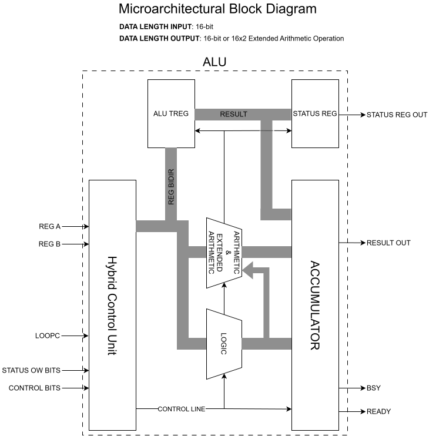

# Arithmetic Logic Unit (ALU)

> This section contains all the [Digital](https://github.com/hneemann/Digital) files for simulating and tinkering, Draw.io, and Graphviz.

The ALU (Arithmetic Logic Unit) is the part of the computer's processor that does all the actual math and logic calculations, like adding numbers or comparing data.

## Modules

##### Registers:

1. ALU Temporary Register 16-bit
   * TREG 16x8
2. Accumulator 16-bit

##### Logic Units:

1. **XOR**
   * NOT & XNOR mode
2. **OR**
3. **AND**

##### Arithmetic Unit:

1. **FADDER**
   * 1 Slave, 1 Master; Dual-FADDER Compute.

##### Controller:

1. Hybrid Control Unit *(Asyncronous Control Unit)*
   * FSM Aided Microcode

## Capability

##### IO data bus length:

* IN
  * REG A 16-bit
  * REG B 16-bit
* OUT (Accumulator)
  * OUTX 16-bit
  * OUTY 16-bit
  * DWORD = OUTY + OUTX *(for extended operation)*

##### Control bits data length:

* Control Bits/OpCode - 8-bits
* Count/Mul - 8-bits
* Status OW Bits - 8-bits

## Operations

##### ***Legend**:*

* ***n** = loop count*
* ***lb** = Leading bit position count*
* ***FSM** = Finite State Machine Operation*
* ***MiCd** = MicroCode Operation*
* ***Ext** = Extended*
* **Bit fields:**

<table>
  <thead>
    <tr>
      <th>7</th>
      <th>6</th>
      <th>5</th>
      <th>4</th>
      <th>3</th>
      <th>2</th>
      <th>1</th>
      <th>0</th>
    </tr>
  </thead>
  <tbody>
    <tr>
      <td>NOT</td>
      <td>FSM:0 / MiCd:1</td>
      <td colspan="6">FSM / MiCd Select Bits</td>
    </tr>
  </tbody>
</table>

##### Basic Operations

| OpCode   | Type | Operation | Clock Cycle | Specialty                                                |
| :------- | :--- | --------- | ----------- | :------------------------------------------------------- |
| 0x00     | FSM  | ADD       | 1           | NA                                                       |
| 0x01     | FSM  | AND       | 1           | NA                                                       |
| 0x02     | FSM  | OR        | 1           | NA                                                       |
| 0x03     | FSM  | XOR       | 1           | NA                                                       |
| 0x04     | FSM  | NAND      | 1           | NA                                                       |
| 0x05     | FSM  | NOR       | 1           | NA                                                       |
| 0x06     | FSM  | XNOR      | 1           | NA                                                       |
| 0x07     | FSM  | SUB       | 1           | NA                                                       |
| **0x80** | FSM  | NOT       | 1           | OpCode + 0x80 will invert the result before accumulator |

##### Extended Operations

* Barrel Shifting

| OpCode | Type | Operation | Clock Cycle | Specialty |
| ------ | :--- | --------- | ----------- | --------- |
| 0x08   | FSM  | ROR       | n+1         | NA        |
| 0x09   | FSM  | ROL       | n+1         | NA        |
| 0x0A   | FSM  | RCR       | n+1         | NA        |
| 0x0B   | FSM  | RCL       | n+1         | NA        |
| 0x0C   | FSM  | SHR       | n+1         | NA        |
| 0x0D   | FSM  | SHL       | n+1         | NA        |

* Extended Operations

| OpCode | Type | Operation | Clock Cycle | Specialty |
| ------ | :--- | --------- | ----------- | --------- |
| 0x0E   | FSM  | ADC       | 1           | NA        |
| 0x0F   | FSM  | TEST      | 1           | NA        |
| 0x10   | FSM  | CMP       | 1           | NA        |
| 0x40   | MiCd | MUL       | n+1         | NA        |
| 0x41   | MiCd | DIV       | lb+1        | NA        |

## System Architecture & Design

#### Microarchitectural Block Diagram

